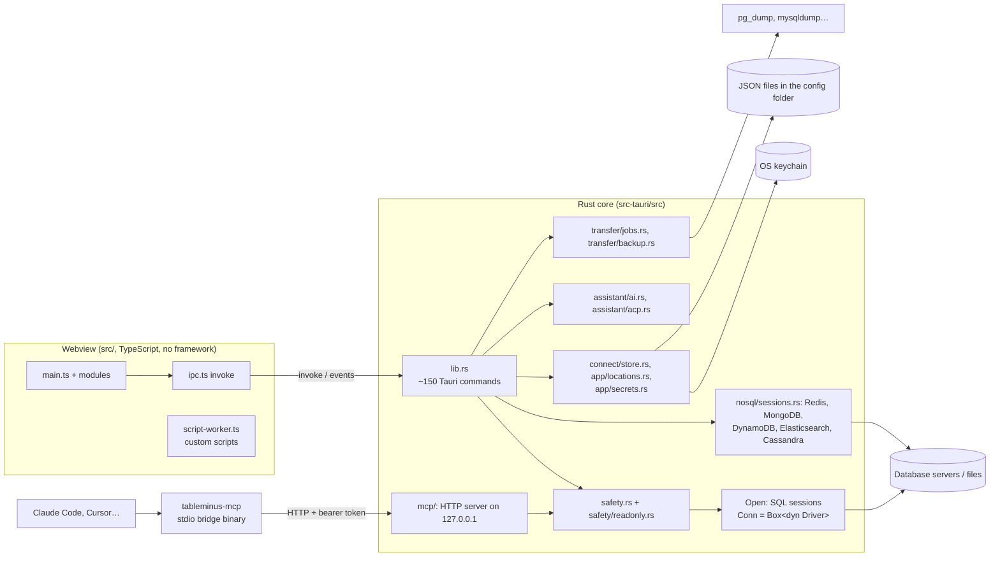
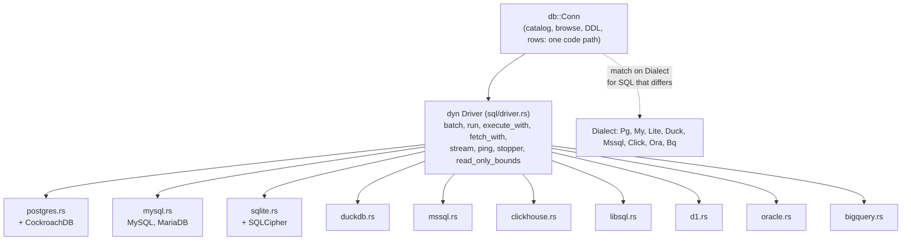

# Architecture

How the code fits together, as of `12be348` (2026-10-18). Module-level detail is in each file's `//!` (Rust) or top comment (TypeScript); this page is the map.

## Shape

## The Rust layout

`src-tauri/src` has `lib.rs` (the commands), `main.rs`, `error.rs`, `bin/` (the MCP server's binary) and one folder per domain, each with a `<folder>.rs` that lists its modules:

| Folder | Holds |
| --- | --- |
| `sql/` | `db.rs` (`Conn`), `driver/` (one file per SQL engine), and what the UI does on them: catalog, browse, rows, DDL, structure, objects, diagram, processes, users |
| `transfer/` | export, import, backup and restore, and the background jobs that run them |
| `nosql/` | Redis, MongoDB, DynamoDB, Elasticsearch, Cassandra and their sessions |
| `connect/` | saved connections and the launcher, SSH tunnels, TLS settings, discovery |
| `safety/` | safe mode (`safety.rs`) and its read-only check (`safety/readonly.rs`) |
| `assistant/` | the AI provider, ACP agents and the MCP server |
| `app/` | the console log, file locations, passcode, plugins, themes, updates and the keychain |

A new engine goes in `sql/driver/` or, when it isn't SQL, in `nosql/` (see [features/engines.md](features/engines.md)).

## The backend boundary

- **`lib.rs` is the only surface the UI can call.** Every `#[tauri::command]` is registered in one `generate_handler!` list. The webview runs with `withGlobalTauri: false` and a strict CSP (`tauri.conf.json`); capabilities are limited to window close/drag and the open/save dialogs (`capabilities/default.json`).
- **Errors** are one `error::Error` enum (thiserror). They serialize as `{ code, message }`; `code` is set only for the errors the UI acts on (`confirm`, `password`, `disconnected`, `vault_locked`…). `src/ipc.ts` turns them into `AppError`, and the UI branches on `codeOf(e)`, never on message text (DEC-012).
- **Events** go from Rust to the UI for long work: `job-progress`/`job-done` (imports, exports), `backup-progress`/`backup-done`, `connection-lost` (keep-alive), `acp` (agent streaming), `mcp` (approvals and activity), `opened` (files and links the OS hands the app).

## SQL engines: `Conn`, `Driver`, `Dialect`

- A driver only runs SQL and returns **every cell as text** (`Option<String>`). Everything above it (catalog queries, browse SQL with filters and paging, DDL generation, staged-row saves, export, import, diagram, users, processes) is written once in `sql/db.rs`, `sql/browse.rs`, `sql/ddl.rs`, `sql/rows.rs`, `sql/structure.rs`, `sql/catalog.rs`, `sql/objects.rs`… and matches on `Dialect` where SQL differs (DEC-005).
- libSQL and D1 are SQLite underneath and use `Dialect::Lite`, so table rebuilds, structure editing and the grid come for free. CockroachDB is a Postgres connection with `flavor: "cockroach"`.
- Adding an engine: [features/engines.md](features/engines.md).

## Sessions

- **SQL:** `Open` holds `HashMap<session key, Arc<Mutex<Live>>>`. A `Live` is the saved connection, the URL in use, the password, the `Conn` and its SSH tunnel (the tunnel lives exactly as long as the connection). One lock per connection, so a slow query blocks only its own connection (DEC-007). The map lock is released before waiting on a connection's lock.
- **Session keys:** a workspace's first tab uses the saved connection's name; another database of the same connection in its own tab is `name\u{1f}n`. The MCP server uses the plain name, so it shares the first session.
- **Not SQL:** Redis, MongoDB, DynamoDB, Elasticsearch and Cassandra each have their own session type and commands (`redis_*`, `mongo_*`…), kept in a generic `sessions::Sessions<S>` under the same keys (`nosql/sessions.rs`, commit `d164f67`).
- **Passcode lock:** `Open.locked`; while set, `Open::get` and the other session maps refuse every request, the MCP server's included. The app starts locked until it knows whether a passcode is set.
- **Keep-alive:** a 30 s loop pings idle connections and emits `connection-lost` for ones that don't answer. Busy connections are skipped.
- **Background jobs** (exports, imports, backups, the process list) open a **connection of their own**, so the workspace stays usable and a job can be cancelled independently.

## A query's path

1. The SQL editor (`editor.ts`, CodeMirror) splits statements (`statements.ts`), asks for parameters, and calls `run_query` through `invoke`.
2. `lib.rs` gets the session, runs `readonly::is_read_only` (sqlparser, per engine dialect) and `safety::check` for the connection's level. If the level wants a click or a password, the command fails with `confirm`/`password`; the UI asks (`safety.ts`) and resends with `confirmed: true` or an `Unlock`.
3. At Alert 2 and Safe 2, SQL the parse calls read-only runs inside the driver's `read_only_bounds` (a read-only transaction; SQLite `query_only`), so the database itself refuses a write hidden in a function.
4. The driver streams rows, stopping at the row limit (default 1,000; at most 100 result sets per call). The query timeout cancels on the server (Postgres cancel, MySQL `KILL QUERY`, SQLite interrupt, attention/`KILL QUERY`/OCI break elsewhere).
5. `app/console.rs` records each statement sent, with password literals masked (`redact`).

Details: [features/safe-mode.md](features/safe-mode.md).

## The UI

- No framework. `index.html` holds the static shell; modules build DOM with the `el()` helper from `dom.ts`. Styling is hand-written CSS with design tokens on `:root` (`styles.css`) plus per-feature stylesheets ([UI-UX.md](UI-UX.md)).
- **`main.ts` (about 1,000 lines) wires the modules together** and keeps the SQL editor, the tab strip, the sidebar tree, the keyboard handlers and the command list. The workspace on screen is one object, `S` (`state.ts`), because a module can't assign another's `let`; the modules ask `main.ts` for the few things it still owns through an init host, as `grid-edit.ts` and `sidebar.ts` do. The split (merged 2026-10-19; the first two attempts were on branches):
  - `state.ts` (`S`, tab types, `call`, `okToDiscard`), `engines.ts` (the engine list, per-engine form shapes, URLs, what each engine supports), `settings.ts` + `settings-defaults.ts`, `dialogs.ts` (menu, popover, confirmations).
  - `connform.ts` (engine picker and connection form), `home.ts` (the launcher's list), `workspaces.ts` + `workspace-tabs.ts` (workspaces, split panes, the strip of workspace tabs), `dbpicker.ts` (Open a Database), `history.ts`.
  - `tabletab.ts` + `table-text.ts` (table tabs), `run.ts` + `run-text.ts` (running SQL and its results), `gridview.ts` (grids, selection, copy).
  - Feature modules (`structure.ts`, `metrics.ts`, `diagram.ts`, `ai.ts`, `redis.ts`, `docview.ts`…) are wired in from `main.ts`. Side-effect imports (Settings tabs, stylesheets) stay in `main.ts` ahead of the modules, because import order is load order.
- **Commands:** `commands.ts` holds one list of app commands that feeds the keyboard handler, the native menu bar (`menu.ts`, rebuilt when shortcuts change), Open Anything (⌘P) and Settings › Shortcuts.
- **Document view:** `docview.ts` is one grid-and-console view shared by MongoDB, DynamoDB, Elasticsearch and Cassandra through a small engine adapter each (`mongo.ts`, `dynamo.ts`, `elastic.ts`, `cassandra.ts`). Redis has its own view (`redis.ts`).
- **Pure logic is kept out of DOM code** in `*-text.ts`, `statements.ts`, `staging.ts`, `chartdata.ts`, `diagram-layout.ts`… so `node --test` can test it.
- **Grid:** `vgrid.ts` renders only rows near the viewport; `staging.ts` holds staged edits with undo/redo; saves go to `rows::save_rows` as one transaction.
- **Settings** live in `settings.json` through `prefs.ts`; localStorage only keeps a copy for a fast start, and the file wins (DEC-014).

## Sandboxes for user code

| What | Where it runs | What it can reach |
| --- | --- | --- |
| Custom scripts (Tools › Run Custom Script) | A Web Worker (`script-worker.ts`) | Only `query`/`execute`/`print`/`table` posted to the page, which go through `run_query` and safe mode |
| Plugins | QuickJS per action (`app/plugins.rs`), 64 MB, 10 s | No files, network or app; the `query` permission gives read-only SQL |
| mongosh scripts | QuickJS (`nosql/mongo/shell.rs`, `shell.js`) | Nothing: the script only records the operations it asks for; Rust runs them after safe mode |

## MCP and AI

- `assistant/mcp/server.rs`: streamable HTTP on 127.0.0.1 (rmcp, stateless), bearer token on every request, tools `list_connections`, `list_tables`, `describe_table`, `run_query`. `src-tauri/src/bin/tableminus-mcp.rs` is the stdio bridge agents launch; it reads the port and token from `mcp-bridge.json`.
- `assistant/ai.rs`: chat with Anthropic or any OpenAI-compatible endpoint; the model's only tool is `run_query`, which the UI shows and runs only on approval. `assistant/acp.rs`: local agents (Claude Code, Codex, Gemini CLI) as child processes over the Agent Client Protocol, reaching the database through the MCP bridge with an in-memory, read-only token.
- Details: [features/mcp-and-ai.md](features/mcp-and-ai.md).

## Constraints that shape the code

- Strict Clippy (`all` denied, `pedantic`, no `unwrap`/`expect`/`panic`), `unsafe_code` forbidden ([CONVENTIONS.md](CONVENTIONS.md)).
- Blocking engines: SQLite and DuckDB run through `driver::blocking` (`block_in_place`: the connection is borrowed, so not `spawn_blocking`); Oracle calls run in `spawn_blocking` and stream rows back over a channel.
- Both rustls crypto providers are compiled in, so `db::install_tls_provider()` installs ring once, called before any rustls config is built; without it MySQL TLS panics.
- The release profile keeps `overflow-checks = true` and `panic = "unwind"`, so a panic fails one command instead of killing the app.

## Where the code differs from the intent

- `README.md`'s Layout table and `Cargo.toml`'s description still describe the three-engine app (ISSUE-001).
- Some engines rest on the SQL parse alone for read-only safety because the server can't enforce it: SQL Server, libSQL, D1 (TODO §24, ISSUE-010).
